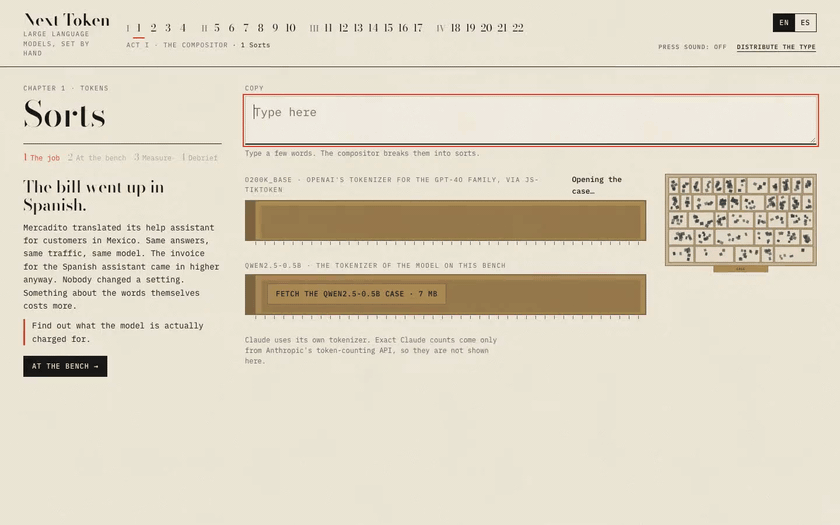

# Next Token

[](https://github.com/rodacato/next-token/actions/workflows/ci.yml)
[](https://github.com/rodacato/next-token/actions/workflows/site-pages.yml)
[](LICENSE)

**Play it in your browser: [rodacato.github.io/next-token](https://rodacato.github.io/next-token/)**

An interactive course on large language models from the inside out: how a model picks the next token, how to build reliable things with it, how models are trained, and how to ship AI features without getting burned. It is set in a letterpress print shop, where every token is a piece of type set by hand, and it runs entirely in your browser, in English and Spanish (Mexico).



[Full recording (MP4)](docs/media/demo.mp4)

## What you learn

22 chapters in four acts. Every chapter has the same four stages: **the job** (a problem at Mercadito, a fictional Mexican online shop), **at the bench** (you work it), **measure** (you predict a number first, then the bench measures it) and **debrief** (what happened, with a reading list). The bench never says "correct" or "wrong"; it compares your prediction with the measurement.

| Act | Chapters | What you do |
|---|---|---|
| I · The Compositor | 1–4 | Break copy into tokens with two real tokenizers and measure what Spanish costs; spread the next-token probability fan from a model running in your page and change temperature and top-p; overflow the context window and lose a fact in the middle; catch a model inventing references, checked against OpenAlex |
| II · The Craft | 5–10 | Run a prompt duel the "better" prompt loses; build an eval with a judge; watch structured output get rejected and retried; execute a model's tool calls yourself; chunk a handbook for retrieval; run an agent overnight with an MCP server and see it refund the same order twice |
| III · The Foundry | 11–17 | Train a tiny GPT on proverbs in the browser (or replay a recorded run) and watch it memorize; train a LoRA adapter on it; guess which training stage of a real model (base, midtrain, SFT or release) wrote each answer; clean a fine-tuning set; decide prompt, retrieval or fine-tune; compare a real fine-tune before and after, including what got worse |
| IV · Commissions | 18–22 | Seeded simulations of a month or a launch: should a feature use AI at all, designing for wrong answers, the bill, an eight-week launch with an injection lab, and a final design reviewed by a board of four |

Every number on the bench is real or labelled. Model outputs are **recorded runs** of real models, shown as "Recorded run · model · date": Qwen2.5-0.5B in the browser for Act I, Claude Haiku 5.5 for Act II, MiniCPM5-2B's checkpoints for Act III. Act IV's simulations take their numbers from earlier chapters, from a dated price table, or from assumptions labelled as such on screen; how each was recorded, and what it found, is in ADRs [7](docs/adr/0007-act-two-llm-port-and-recordings.md), [9](docs/adr/0009-minicpm-recordings-and-finetune.md) and [10](docs/adr/0010-act-four-simulations.md). With no key and no download the whole course works on those recordings. You can also opt in to downloading Qwen2.5-0.5B (512 MB, or SmolLM2-135M at 137 MB) to run Act I live, or use your own Anthropic, OpenAI or OpenAI-compatible key for Act II. Your key stays in the browser, every live run shows its estimated cost first, and a session budget (default $1) stops spending past it.

## Run it

Needs Node 22.22 or newer (or 24.15+) and npm.

```bash
npm install
npm run dev        # http://localhost:5317
```

For the end-to-end tests, install Chromium once: `npx playwright install chromium`. They run on recorded runs, so they never download a model.

## Checks

| Script | What it does | Where it runs |
|---|---|---|
| `npm run check` | typecheck, lint, unit tests and `i18n:check` | `Check` on every push and PR (plus `build`) |
| `npm run test:e2e:smoke` | the `@smoke` end-to-end test (chapter 1) | `Smoke` on every push and PR |
| `npm run test:e2e` | every end-to-end test, all four acts | nightly and on demand |
| `npm run i18n:check` | missing or extra keys, empty strings and mismatched placeholders in every locale | in `check` |
| `npm run build` | regenerates `public/scroll.json`, then builds into `dist/` | `Check`, and every push to `main` publishes to GitHub Pages |
| `npm run demo` | records `docs/media/demo.mp4` and `demo.gif` from the production build (needs `ffmpeg`) | by hand |

CI also runs Dojo's scroll conformance suite against the production build (`Conformance`).

The recordings are refreshed by hand, one command per kind, documented in [src/recordings/README.md](src/recordings/README.md). Claude answers are recorded through the Claude Code CLI on a subscription (ADR 4), MiniCPM5 through mlx-lm on Apple silicon (ADR 9).

## Architecture

- **Content is data.** Chapters live in `src/content/chapters/` as JSON validated with Zod 4. A chapter's `kind` names the bench that runs it, so adding one is a JSON file plus its strings. Every visible string is a key in `src/i18n/locales/<locale>.json`.
- **Ports with swappable adapters.** `LlmPort` (`src/llm/`) has Anthropic, OpenAI, OpenAI-compatible, Dojo host and recorded adapters. Recorded runs are found by a hash of the request, so changed content shows "no recording" instead of a wrong answer. `HostBridge` (`src/host/`) is standalone or embedded.
- **Models off the main thread.** The inference worker (`src/model/`) runs Transformers.js on WebGPU or WASM; the trainer worker (`src/trainer/`) runs a ~110k-parameter GPT on TensorFlow.js core.
- **Deterministic simulations.** Act IV's simulations are pure functions in `src/sim/`, seeded per request, so the same plan replays the same month and a design change only moves results through its mechanism.

Decisions are in [docs/adr/](docs/adr/), the phase plan in [docs/PLAN.md](docs/PLAN.md), and the design direction and screenshots of each phase in [design/](design/).

## Embedding in Dojo

[Dojo](https://github.com/rodacato/dojo) is a self-hosted practice space for developers that embeds courses like this one in an iframe. Next Token runs standalone or embedded through Dojo's scroll protocol v0 (ADR 5): a manifest generated from content at `public/scroll.json`, one unit per chapter, a nonce handshake with origin checks, and a fallback to standalone after three seconds. Progress sent to Dojo is self-reported. The course also proposes an `llm` message so a host could serve completions; Dojo does not grant it today, so the course uses recordings or your key.

## Contributing

- **A chapter:** a JSON file in `src/content/chapters/` whose `kind` is an existing bench, its strings in every locale, and its sources in `src/content/sources.json`. Benches that replay model output need recordings too; `npm run recipes` lists what is missing.
- **A language:** copy `src/i18n/locales/en.json` to a new locale file and translate it; it is discovered automatically and `npm run i18n:check` tells you what is missing. Recorded runs are per language, so a new one also needs its recordings.
- Run `npm run check` and `npm run test:e2e` before opening a pull request.

## Sources

Each chapter's debrief cites what it is built on: about forty papers, docs and talks, among them Petrov et al. on tokenizer unfairness, Holtzman et al. on degeneration, Liu et al.'s *Lost in the Middle*, Kalai et al. on hallucination, Lewis et al. on RAG, Hu et al.'s LoRA, Ouyang et al.'s InstructGPT, DPO, Tülu 3, Karpathy's nanoGPT and tokenizer lectures, Chip Huyen's *AI Engineering*, Hamel Husain on evals, OWASP LLM01, Greshake et al. on indirect prompt injection, and Anthropic's and OpenAI's documentation. Full list in [src/content/sources.json](src/content/sources.json).

## License

[MIT](LICENSE) © Adrian Castillo.

Third-party material:
- **Models**, downloaded from Hugging Face only when you opt in: Qwen2.5-0.5B and SmolLM2-135M-Instruct (Apache-2.0), multilingual-e5-small (MIT). MiniCPM5-2B (Apache-2.0) is not shipped; only its recorded answers are.
- **Fonts:** Bodoni Moda and IBM Plex Mono, SIL Open Font License 1.1.
